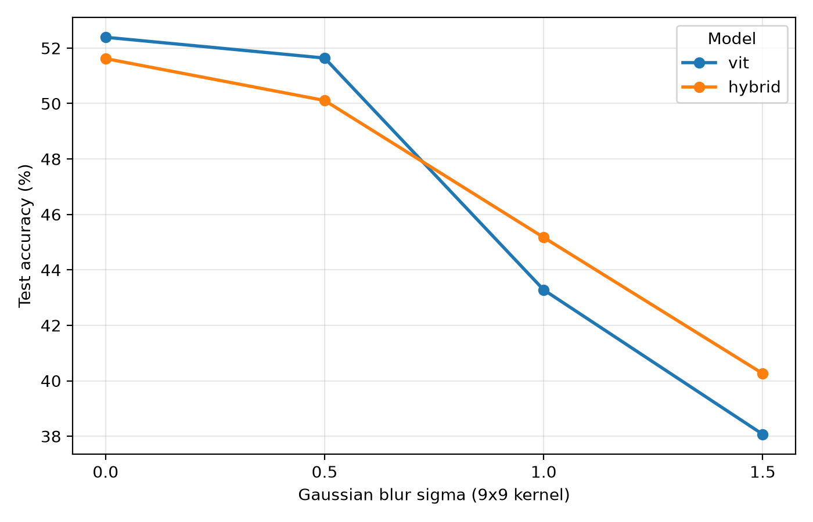
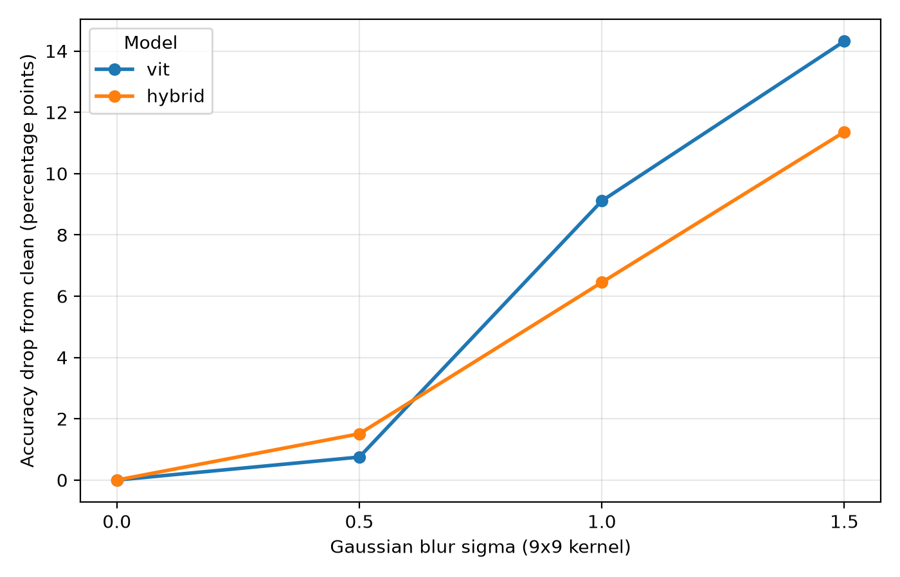

# Do Transformers Need Glasses?
## A Small Study of Patch and Convolutional Tokenizers

An educational PyTorch project that compares a small patch-based Vision
Transformer (ViT) with a CNN-Transformer hybrid on CIFAR-10. The question is
simple: when the Transformer encoder is held fixed, how do a linear patch
tokenizer and a small convolutional tokenizer differ on clean images and under
Gaussian blur?

This is a small adaptation built to learn the mechanics of tokenization,
self-attention, residual encoder blocks, training loops, and controlled
evaluation. It is **not** a reproduction of either cited paper's architecture,
data scale, optimization recipe, or benchmark result.





## Research Question

Does replacing non-overlapping image patches with a two-layer convolutional
tokenizer change clean CIFAR-10 accuracy or sensitivity to deterministic
Gaussian blur, when both models use the same small Transformer encoder?

## What Is Implemented

- manual patch extraction and linear patch projection
- scaled dot-product, multi-head self-attention, and pre-normalized encoder blocks
- a two-block, four-head TinyViT classifier with learned positional embeddings
- a hybrid variant that replaces only the tokenizer with two stride-2 convolutions
- fixed-split training, resumable checkpoints, validation selection, and blur evaluation
- paired per-image prediction, class-recall, and official-test reporting

## Architecture Comparison

Both models receive an image tensor `[B, 3, 32, 32]`, emit 64 tokens of width
64, process them through two Transformer encoder blocks, mean-pool tokens, and
classify into 10 CIFAR-10 classes.

| Stage | Patch ViT | CNN-Transformer hybrid |
|---|---|---|
| Tokenizer input | `[B, 3, 32, 32]` | `[B, 3, 32, 32]` |
| Local representation | 64 disjoint `4x4` RGB patches: `[B, 64, 48]` | Conv `3 -> 32`, stride 2: `[B, 32, 16, 16]`; then Conv `32 -> 64`, stride 2: `[B, 64, 8, 8]` |
| Token tensor | linear projection to `[B, 64, 64]` | flatten and transpose to `[B, 64, 64]` |
| Receptive field at tokenization | one non-overlapping `4x4` patch | theoretical `7x7` receptive field, effective stride 4, with overlapping neighbors |
| Shared encoder | 2 blocks, width 64, 4 heads, MLP width 256 | same |
| Trainable parameters | 107,466 | 123,722 |

The hybrid therefore changes both the tokenizer's locality/overlap and model
capacity; it is not a parameter-matched ablation.

## Data, Training, And Checkpoints

Training uses CIFAR-10's training partition. A permutation generated with seed
42 supplies 10,000 training images and a disjoint 5,000-image validation set.
Images are converted to tensors and normalized per channel as
`(image - 0.5) / 0.5`.

Both runs use 20 epochs, batch size 128, cross-entropy loss, and AdamW with
learning rate `3e-4` and weight decay `0.01`. There is no augmentation or
learning-rate scheduler in `train.py`. The checkpoint rule is strict: `best.pt`
is replaced only when validation accuracy is greater than the previous best.
That selected epoch 17 for the ViT at 54.22% validation accuracy and epoch 19
for the hybrid at 51.48%.

## Frozen Gaussian Blur Protocol

The official test comparison uses those selected checkpoints on all 10,000
CIFAR-10 test images. Sigma values are 0.0, 0.5, 1.0, and 1.5. Nonzero blur
uses a fixed `9x9` Gaussian kernel; sigma 0 is an identity operation. Blur is
applied to floating-point tensors in `[0, 1]`, followed by exactly one existing
normalization step. Under each condition, both models receive the same tensor
batch in `eval()` and `torch.inference_mode()`.

The frozen protocol, checkpoint SHA-256 hashes, versions, and exact evaluation
settings are recorded in `reports/test_comparison/protocol.json`. A curated
copy of the aggregate result table is tracked at
[`docs/assets/test_results.csv`](docs/assets/test_results.csv).

## Official Test Results

| Sigma | ViT accuracy | ViT drop from clean | Hybrid accuracy | Hybrid drop from clean |
|---:|---:|---:|---:|---:|
| 0.0 | 52.39% | 0.00 pp | 51.62% | 0.00 pp |
| 0.5 | 51.64% | 0.75 pp | 50.11% | 1.51 pp |
| 1.0 | 43.28% | 9.11 pp | 45.17% | 6.45 pp |
| 1.5 | 38.07% | 14.32 pp | 40.26% | 11.36 pp |

On clean test images and at sigma 0.5, the ViT is ahead by 0.77 and 1.53
percentage points. At sigma 1.0 and 1.5, the hybrid is ahead by 1.89 and 2.19
points. This reproduces the validation result's crossover pattern, but it does
not identify why it occurs.

## Interpretation And Limits

The measurements show that these two saved models respond differently as blur
increases. They do not establish that convolution causes the difference, that
one model has a particular shape or texture bias, or that attention explains a
prediction. Blur suppresses fine spatial detail, but this single corruption is
not a causal probe of internal representation.

Important limits:

- one training run per architecture
- unequal parameter counts and different tokenizers
- different shuffled training batch orders because model construction consumes random numbers differently
- a 10,000-image training subset, fixed 20-epoch budget, and untuned settings
- one corruption family and 32x32 images
- no temporal inputs or spiking neurons in this introductory project

## Setup And Commands

```powershell
py -3.11 -m venv .venv
.\.venv\Scripts\python.exe -m pip install -r requirements.txt
```

Start a fresh training run in a new directory:

```powershell
.\.venv\Scripts\python.exe train.py --model vit --epochs 20 --train-size 10000 --batch-size 128 --run-dir runs/vit_example
.\.venv\Scripts\python.exe train.py --model hybrid --epochs 20 --train-size 10000 --batch-size 128 --run-dir runs/hybrid_example
```

Resume an existing run by using its directory and a larger epoch target:

```powershell
.\.venv\Scripts\python.exe train.py --model vit --epochs 30 --train-size 10000 --batch-size 128 --run-dir runs/vit_example
```

Evaluate the saved baseline checkpoints:

```powershell
.\.venv\Scripts\python.exe compare_blur.py
.\.venv\Scripts\python.exe analyze_blur_predictions.py
.\.venv\Scripts\python.exe evaluate_test_blur.py
```

`evaluate_test_blur.py` reuses a complete report only when its frozen protocol
matches the current checkpoints; it otherwise refuses to overwrite it.

## Reproducibility Snapshot

The measured reports were produced in the installed environment below:

| Package | Installed version |
|---|---|
| torch | `2.15.0+cpu` |
| torchvision | `0.29.2+cpu` |
| matplotlib | `3.11.2` |

`requirements.txt` lists only these direct runtime dependencies. The exact
Torch and TorchVision versions used for official test inference are also stored
in the frozen test protocol.

## Source Map

| File | Purpose |
|---|---|
| `vit.py` | patch embedding and TinyViT classifier |
| `hybrid.py` | convolutional tokenizer and hybrid model |
| `attention.py` | single- and multi-head scaled dot-product attention |
| `encoder.py` | pre-normalized Transformer encoder block |
| `train.py` | fixed split, training, checkpointing, and resume logic |
| `compare_blur.py` | validation blur comparison |
| `analyze_blur_predictions.py` | paired validation prediction analysis |
| `evaluate_test_blur.py` | frozen official-test blur evaluation |
| `docs/report.md` | project report and discussion |

## References

- Vaswani et al., [Attention Is All You Need](https://arxiv.org/abs/1706.03762)
- Dosovitskiy et al., [An Image Is Worth 16x16 Words: Transformers for Image Recognition at Scale](https://arxiv.org/abs/2010.11929)
