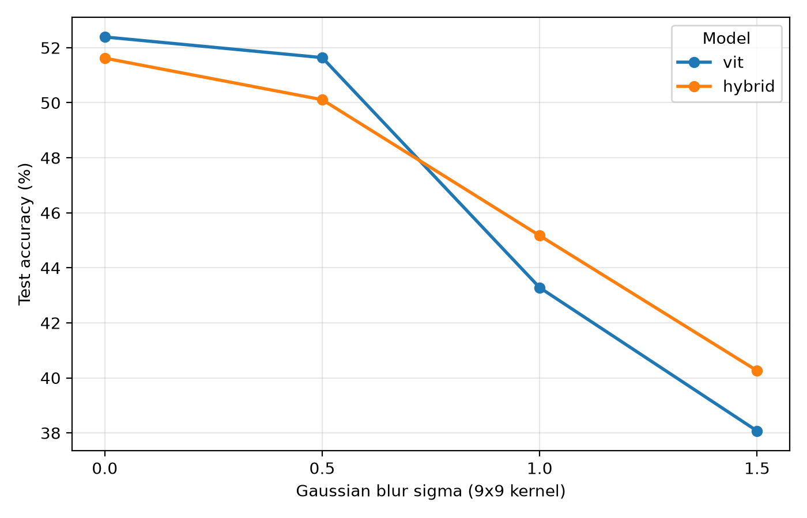
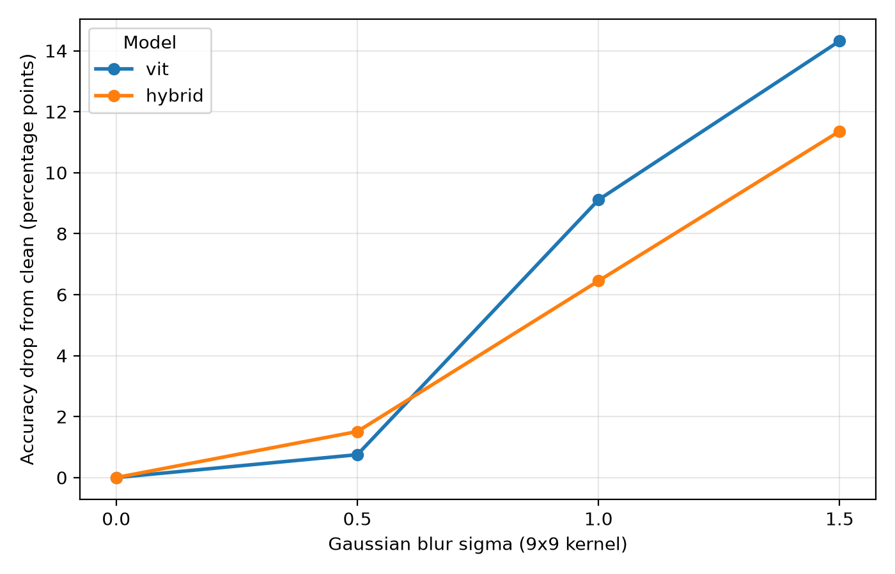

# Project Report: Patch Tokens, Convolutional Tokens, And Blur

## Question And Motivation

This weekend project asks a focused question: if a small Vision Transformer
keeps the same encoder but changes how an image becomes tokens, does that alter
clean CIFAR-10 accuracy or sensitivity to Gaussian blur? The patch ViT maps
non-overlapping image patches to vectors. The hybrid instead uses a short
convolutional stem before the same Transformer. The comparison separates global
token-to-token communication from the local evidence supplied to attention.

The project implements attention, an encoder, both tokenizers, training,
checkpointing, and evaluation in PyTorch. It is a small adaptation, not a
reproduction of the much larger, differently trained cited systems.

## Method

Each model receives CIFAR-10 images shaped `[B, 3, 32, 32]`. The patch ViT
extracts an `8x8` grid of non-overlapping `4x4` RGB patches. Flattening creates
64 vectors of width 48, and a linear layer produces `[B, 64, 64]` tokens. The
hybrid applies a `3 -> 32` convolution and then a `32 -> 64` convolution, both
with `3x3` kernels, stride 2, and padding 1. This produces `[B, 64, 8, 8]`,
which flattens to the same `[B, 64, 64]` token sequence. Its token grid has
effective stride four and a theoretical `7x7` receptive field, so neighbors overlap.

After tokenization, both models add learned positional embeddings and use two
pre-normalized Transformer blocks. Each block has four attention heads at
embedding width 64 and an MLP hidden width of 256. Tokens are mean-pooled and
passed to a 10-class linear classifier. The ViT has 107,466 trainable
parameters; the hybrid has 123,722. The hybrid is therefore not merely a
different inductive bias: it also has 15.1% more parameters.

The training data is a fixed split of CIFAR-10's training partition. A seeded
permutation supplies 10,000 training images and a disjoint 5,000-image
validation set. Both models use batch size 128 for 20 epochs, cross-entropy
loss, AdamW with learning rate `3e-4` and weight decay `0.01`, and input
normalization `(image - 0.5) / 0.5`. The best checkpoint is selected by strict
improvement in validation accuracy: epoch 17 for the ViT at 54.22%, and epoch
19 for the hybrid at 51.48%.

The final evaluation uses all 10,000 official CIFAR-10 test images. Each image
is converted to a float tensor in `[0, 1]`. Blur is then applied with sigma
0.0, 0.5, 1.0, or 1.5; nonzero conditions use one fixed `9x9` Gaussian kernel,
and sigma 0.0 leaves the tensor unchanged. Normalization happens once after
blur. The same batch tensor is passed to both models under `eval()` and
`torch.inference_mode()`. The checkpoint hashes, package versions, and settings
are frozen in [`reports/test_comparison/protocol.json`](../reports/test_comparison/protocol.json).

## Results

The aggregate results are tracked in
[`docs/assets/test_results.csv`](assets/test_results.csv) and shown below.

| Sigma | ViT accuracy | ViT drop | Hybrid accuracy | Hybrid drop |
|---:|---:|---:|---:|---:|
| 0.0 | 52.39% | 0.00 pp | 51.62% | 0.00 pp |
| 0.5 | 51.64% | 0.75 pp | 50.11% | 1.51 pp |
| 1.0 | 43.28% | 9.11 pp | 45.17% | 6.45 pp |
| 1.5 | 38.07% | 14.32 pp | 40.26% | 11.36 pp |

On clean test images, the ViT is ahead by 0.77 percentage points. It remains
ahead by 1.53 points at sigma 0.5. At sigma 1.0, the hybrid leads by 1.89
points; at sigma 1.5, it leads by 2.19 points. The same qualitative crossover
appeared in the earlier 5,000-image validation blur comparison: the ViT scored
slightly higher at clean and light blur, while the hybrid scored higher at the
two stronger blur levels.

Paired predictions show the same shift. At sigma 1.0, 1,407 images were correct
only for the hybrid and 1,218 only for the ViT; at sigma 1.5, the counts were
1,265 and 1,046. These paired outcomes show disagreement, not why predictions
changed.

## Interpretation

The measured result is narrow but useful: in this setup, the hybrid loses less
test accuracy than the patch ViT at stronger blur, even though it begins with
slightly lower clean accuracy. One possible explanation is that overlapping
convolutional tokenization changes the information presented to the shared
Transformer when local image detail is smoothed. That is a hypothesis, not a
demonstrated mechanism. The hybrid also has more parameters, and training did
not control the shuffled batch order, so tokenizer locality cannot be isolated
as the cause.

Gaussian blur suppresses fine spatial detail. It does not directly measure
shape bias, texture reliance, attention behavior, or a causal internal
mechanism. Neither the plotted curves nor individual prediction examples prove
what representation a model used. A stronger study would add multiple random
seeds, capacity-matched variants, more corruption types and severities, and
tests designed specifically for shape-versus-texture hypotheses.

## Limitations

- There is one training run per architecture, so seed-to-seed variation is unknown.
- The parameter counts are unequal, and the hybrid's tokenizer adds 16,256 parameters.
- The models receive different shuffled training batch orders because their construction consumes different amounts of random state.
- Training uses a small 10,000-image subset and a 20-epoch budget rather than tuned, architecture-specific schedules.
- Gaussian blur is one corruption family; it cannot characterize general robustness.
- CIFAR-10 images are only `32x32`, limiting the spatial detail available to either tokenizer.
- This introduction contains no temporal inputs or spiking neurons.

## What I Learned About Transformers

Implementing the model made tokenization tangible. Attention does not operate
directly on pixels here: it operates on 64 learned vectors. A patch tokenizer
projects non-overlapping local pixels, while a convolutional tokenizer mixes
nearby pixels before attention. The shared encoder then computes queries, keys,
and values for every token.

I also learned that a fair-looking experiment needs more than the same dataset
and optimizer. Checkpoint selection, preprocessing order, capacity, random
number consumption, batch order, and a frozen evaluation all affect what can
be claimed. The saved protocol and outputs make the project easier to inspect
without overstating its conclusions.
